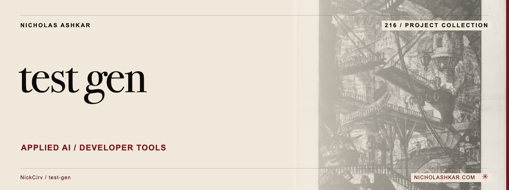

# test-gen

Analyze a JavaScript, TypeScript or Python source file and draft tests using Anthropic.

> **Local repair candidate.** This checkout restores the missing CLI from source revision `9bc9f9a5ab6c7061bd7b7d2bdf2ec2eef4ce167b`. Offline behavior tests pass; live model generation remains unverified. Nothing here implies an upstream release. See [repair evidence](REPAIR-REPORT.md).

## Quickstart

Use Node.js 20 or later. Begin with local analysis from this candidate checkout:

```bash
npm install --ignore-scripts --no-audit --no-fund
node bin/gen.js --help
node bin/gen.js /absolute/path/to/source.js --dry-run
```

Dry-run reads the source and nearby configuration, prints a JSON plan, and makes no API call or file write. It works without an API key. Help and dry-run were exercised as real CLI subprocesses using temporary fixtures.

## Draft tests

Generation requires `ANTHROPIC_API_KEY` in the environment. It sends the complete selected source, extracted symbols/imports to Anthropic. The CLI does not read or replace an existing test file. The inherited generator requests `claude-haiku-4-5`; model availability and live responses were not checked.

```bash
# Model-backed examples: not executed in this repair review.
node bin/gen.js /absolute/path/to/source.js
node bin/gen.js /absolute/path/to/source.js --output /absolute/path/to/source.test.js
```

By default the generated code is printed to stdout. With `--output`, the parent directory must exist. The output path must be new: existing files are always refused, and there is no `--force` mode. Generate a separate draft and merge reviewed assertions manually so existing tests are preserved. Review generated assertions and imports before running the result in your test environment.

## Command reference

| Option | Purpose | Default |
| --- | --- | --- |
| `--dry-run` | Analyze and print a plan, offline and without writes | Off |
| `--framework NAME` | Select `jest`, `vitest`, `mocha`, or `pytest` | Detected, then Jest for JS/TS or pytest for Python |
| `--output PATH`, `-o PATH` | Write the draft to a file | stdout |
| `--help` | Show help without generation | No arguments also show help |

Python requires pytest; JS/TS accept Jest, Vitest or Mocha. Invalid arguments, unsupported files/framework combinations, provider errors and empty responses return a nonzero status. Output cannot be an existing file, the source file, a symlink or a directory. Exclusive creation also refuses a path that appears while generation is in progress.

## Analysis and limits

The analyzer uses regular expressions for exports and imports; it is not a full parser and can miss or misidentify symbols. Framework detection searches nearby manifests/configuration rather than proving an installed runner works. The lower-level generator retains an optional existing-test context argument, but the CLI does not use it: generated drafts are separate files and no merge or deduplication guarantee is made.

Generated output is untrusted draft code. It is neither executed nor syntax-checked by this CLI, and a successful request does not establish passing tests, complete coverage or correct behavior. The prompt's import-path guidance is heuristic. No current API pricing or model compatibility claim is made.

## Development and verification

```bash
npm test
```

Nine tests passed on Node.js 26.7.0. They cover real help/dry-run startup without credentials, source analysis, mocked SDK generation, fresh file output and preservation of existing tests, invalid input, provider/empty-response failures, and an output path appearing during generation. Every generation test uses injected mocks; no live Anthropic call or generated-test suite was executed. Node 20 and other platforms remain untested.

## License and author

[MIT license](LICENSE). [Nicholas Ashkar](https://nicholashkar.com#oxblood-contact) — applied AI, systems and consulting.

<a id="install"></a>
<a id="usage"></a>
<a id="how-it-works"></a>
<a id="supported-languages-and-frameworks"></a>
<a id="requirements"></a>
<a id="what-it-is-not"></a>
